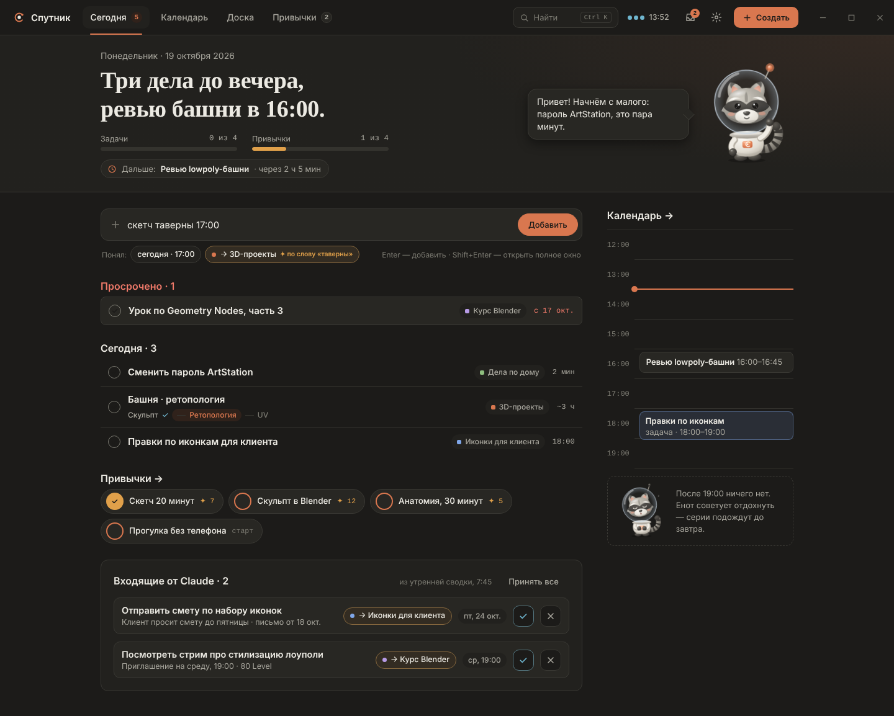
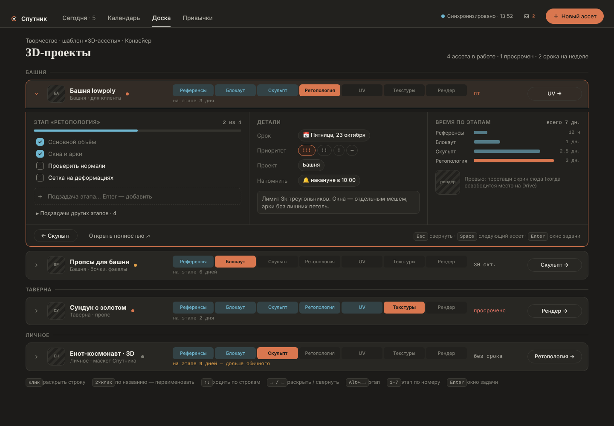
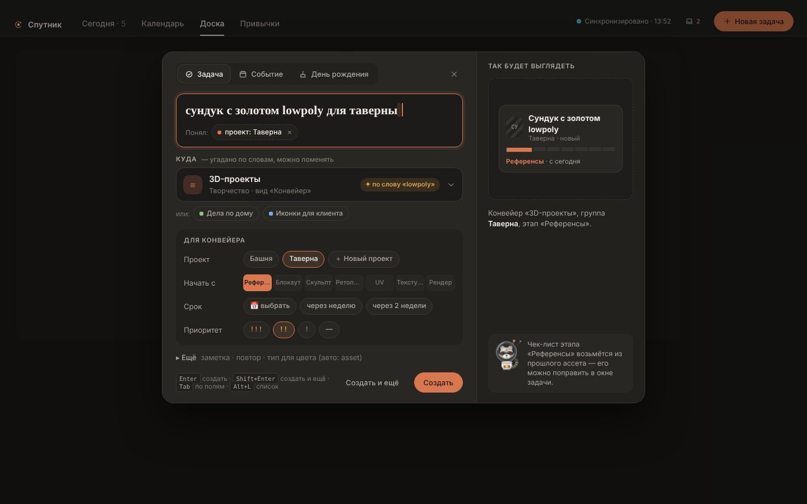

<h1 align="center">🛰 Спутник</h1>

Трекер задач и привычек для Windows поверх Google Задач и Google Календаря. 
Канбан, «Конвейер» для 3D-ассетов, стикеры, календарь недели, привычки с сериями и напоминания в Telegram.

<a href="https://github.com/Siponik/sputnik/releases/latest"><b>⬇ Скачать для Windows</b></a>

## Что умеет

- **Сегодня** — задачи и события дня, «Дальше: … через 20 мин», строка быстрого добавления: пишешь «созвон завтра 15:00 !!» — Спутник сам понимает дату, время, приоритет и список.
- **Доски** — канбан, «Конвейер» (строка — ассет, дорожка этапов: блокинг → хай-поли → ретопо → UV → текстуры), стикеры для простых дел, обычный список. Свои шаблоны досок и сферы (группы списков).
- **Календарь** — неделя и месяц, события Google, задачи со временем, дни рождения и праздники; задачи перетаскиваются по сетке, енот подсказывает свободное окно.
- **Привычки** — расписание, серии, вехи 7 · 21 · 50 · 100 дней.
- **Напоминания в Telegram** — через бота [@SputnikTasksBot](https://t.me/SputnikTasksBot): кнопки «✓ Готово» и «⏰ Через час», задачи можно писать боту текстом, `/today` и `/week`.
- Учёт времени, повторяющиеся задачи, поиск (Ctrl K), горячие клавиши, тёмная и светлая тема, обновление прямо из приложения.

 

## Как начать

1. Скачай `.msi` из [последнего релиза](https://github.com/Siponik/sputnik/releases/latest) и установи. Если Windows покажет синее окно «Защитник Windows предотвратил запуск» — «Подробнее» → «Выполнить в любом случае» (установщик пока не подписан сертификатом).
2. Войди через Google. Спутник ещё не прошёл проверку Google, поэтому будет предупреждение «Приложение не проверено» — «Дополнительно» → «Перейти к Sputnik».
3. Отметь, какие списки и календари показывать, — и всё.
4. Напоминания в Telegram (по желанию): «Настройки» → «Напоминания» → «Telegram» → «Открыть бота», отправь ему `/start` и введи код из 6 цифр.

Пока Спутник в открытом тесте: войти могут до 100 человек.

## Где хранятся данные

- Задачи и события — в твоих Google Задачах и Google Календаре. Своего сервера с твоими задачами нет.
- Поля Спутника (статус на доске, приоритет, время, привычки) — файл на компьютере и копия в скрытой папке приложения на твоём Google Диске, чтобы два компьютера видели одно и то же.
- Telegram-бот получает только то, что нужно для напоминаний: названия и время задач на ближайшую неделю. Доступа к Google у него нет. Отключить — `/unlink` в боте или «Отключить» в настройках.

## Для разработчиков

| Папка | Что там |
|---|---|
| `tracker/` | Приложение: Tauri 2 + Svelte 5. `npm install`, `npm run tauri dev`, тесты — `npm test` |
| `bot/` | Общий Telegram-бот на Cloudflare Workers + D1 ([README](bot/README.md)) |
| `reminders/` | Личный бот автора на Google Apps Script |
| `design/` | Макеты экранов и енот-космонавт |
| `docs/` | Дизайн v2, планы, Android |

Сборка установщика и релиз — GitHub Actions (`.github/workflows/tracker-build.yml`).
